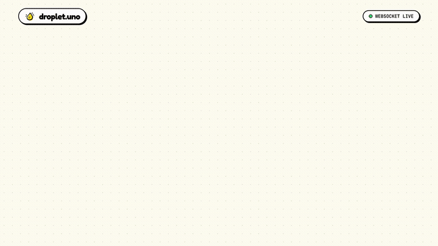

# 💧 Droplet

<div align="center">

```
  ____                 _      _   
 |  _ \ _ __ ___  _ __ | | ___| |_ 
 | | | | '__/ _ \| '_ \| |/ _ \ __|
 | |_| | | | (_) | |_) | |  __/ |_ 
 |____/|_|  \___/| .__/|_|\___|\__|
                 |_|               
```

**Temporary Peer Sharing Without Accounts. Create a room. Drop anything. Pick it up anywhere. Let it disappear.**

[](https://droplet.uno)

[](https://opensource.org/licenses/MIT)
[](https://www.typescriptlang.org/)
[](https://react.dev/)
[](https://vitejs.dev/)
[](https://nodejs.org/)
[](https://expressjs.com/)
[](https://www.sqlite.org/)
[](https://aws.amazon.com/s3/)
[](https://vitest.dev/)
[](https://github.com/idi01-git/Droplet)

<br/>

> 🌐 **Live Production App:** [**https://droplet.uno**](https://droplet.uno) — Instant peer sharing, no accounts required!

<br/>

[⚡ Live Demo](https://droplet.uno) • [Product Video](#-video-demo) • [Key Features](#-key-features) • [Architecture](#-architecture--direct-to-s3-transfers) • [Security](#-anti-brute-force--security-measures) • [Quick Start](#-quick-start) • [Deployment](#-production-deployment)

</div>

---

## 🎬 Video Demo

<div align="center">

<a href="https://github.com/idi01-git/Droplet/raw/main/assets/droplet-demo.mp4">
  
</a>

<p align="center">
  <em>⚡ <b>Live Animated Walkthrough</b> (loops above) • Click the banner or <a href="https://github.com/idi01-git/Droplet/raw/main/assets/droplet-demo.mp4"><b>watch full 1080p video with audio</b></a>.</em>
</p>

</div>

---

## 📖 Overview

**Droplet** eliminates the friction and security risks of transferring terminal snippets, code blocks, links, photos, and files between devices—such as your personal laptop, university lab terminals, or borrowed workstations.

Logging into personal accounts (Google Drive, Slack, Discord, Telegram, or personal email) on untrusted computers leaves session cookies, saved passwords, and history behind. **Droplet flips this model entirely:**

1. Click **Create a Room** — no signups, passwords, or emails.
2. Share a memorable **4-digit numeric code** or point your phone's camera at the **in-modal QR code**.
3. Drop items with **sub-second real-time broadcast** across all peers.
4. Download single items or a compiled **ZIP archive** (up to 200 MiB).
5. Everything strictly **self-destructs within 24 hours** (or instantly when destroyed by the owner).

---

## ✨ Key Features

- ⚡ **Zero Signups, Zero Friction:** Instant access from any browser on any device.
- 🔢 **Human-Friendly 4-Digit Room Codes:** Simple 4-digit codes (`0000`–`9999`) backed by 256-bit cryptographic bearer tokens and anti-brute-force rate limiting.
- 📷 **In-Modal Live Camera QR Scanner:** Point your phone camera or laptop webcam at the host's screen to join instantly. Features dual-camera fallback, haptic vibration feedback, and custom Neo-Brutalist HUD laser brackets.
- 🔄 **Real-Time WebSocket Sync:** Powered by `ws`. Uploads, new notes, and file deletions reflect instantaneously across all peers without polling.
- 🗄️ **Direct-to-S3 Pre-Signed Transfers:** Files stream directly between the user's browser and AWS S3 edges via short-lived pre-signed URLs, preventing Node server Out-Of-Memory (OOM) crashes and eliminating server bandwidth billing.
- 📦 **One-Click "Download All" ZIP:** Packages all room notes and files into a bounded ZIP archive on the fly with collision-free filenames and a compiled `room-notes.txt`.
- ⏳ **Guaranteed 24-Hour Self-Destruction:** All rooms and objects are automatically purged from the database and S3 buckets after 24 hours by an active background worker.
- 👑 **Granular Role Isolation:** Cryptographic session tokens separate room creators (owner permissions: destroy room, revoke tokens) from participants.
- 🎨 **Neo-Brutalist Visual Language:** Vibrant `#FFE000` yellow, tactile `4px 4px 0 #000` drop shadows, bold `2.5px` black borders, and arcade-like physical clicks.
- 📱 **100% Mobile Responsive:** Tailored for seamless usage across mobile phones, tablets, and desktops.

---

## 🛡️ Anti-Brute-Force & Security Measures

Can someone spam random 4-digit codes to hijack active rooms? **No.**

| Defense Layer | Security Implementation | Result |
| :--- | :--- | :--- |
| **IP Lockout Throttling** | Strict sliding-window rate limiter tracks failed join attempts per IP (`server/src/middleware/rateLimit.ts`). | **5 wrong attempts = 5-minute hard lockout** (HTTP 429). Guessing 50% of the 10,000 code space would take **83+ hours**, by which time the room has long expired. |
| **Code Hashing in DB** | 4-digit codes are stored as SHA-256 hashes (`code_hash`) in SQLite. | Plaintext codes are never queryable or exposed in database dumps. |
| **Active & Unexpired Filter** | DB lookups strictly check: `WHERE code_hash = ? AND status = 'active' AND expires_at > now`. | Expired or deleted rooms immediately return 404. |
| **Cryptographic Sessions** | Joining via code only grants a participant session token. | Participants cannot delete rooms or hijack owner administration. |
| **Room Creation Throttling** | Max 3 active unexpired rooms per IP; max 5 creations per 10 minutes. | Prevents attackers from flooding the code namespace. |

---

## 🏗️ Architecture & Direct-to-S3 Transfers

Droplet uses a high-performance **hybrid architecture** that completely offloads heavy binary payloads to cloud storage while maintaining lightweight metadata and real-time state in Node.js:

```
┌────────────────────────────────────────────────────────────────────────┐
│                              CLIENT TIER                                │
│          React 18 + TypeScript + Vite + Vanilla CSS Neo-Brutalist       │
└────────┬───────────────────────────────┬───────────────────────────────┘
         │ HTTPS REST API                │ WSS Realtime Sync
         ▼                               ▼
┌────────────────────────────────────────────────────────────────────────┐
│                              SERVER TIER                                │
│                     Node.js + Express (Render.com)                      │
│                                                                        │
│  • SQLite (WAL mode): Rooms, sessions, text items, quotas, rate limits  │
│  • S3 Presigner: Generates 15m PUT upload & 60s GET download tickets    │
│  • Background Worker: 60s periodic expiry & orphan cleaner             │
│  • WebSocket Hub: Broadcasts real-time events to room peers            │
└────────┬───────────────────────────────────────────────────────────────┘
         │
         │ Direct Pre-Signed Transfer (Zero Node Server RAM/Bandwidth!)
         ▼
┌────────────────────────────────────────────────────────────────────────┐
│                             STORAGE TIER                                │
│                       AWS S3 / Cloudflare R2                            │
│                                                                        │
│  • Direct Browser PUT/GET via Short-Lived Pre-Signed URLs              │
│  • 15-Minute Ephemeral Upload Tickets & 60-Second Download Expirations │
│  • Lifecycle Rule: 48-Hour Automatic S3 Purge (Zero maintenance)      │
└────────────────────────────────────────────────────────────────────────┘
```

---

## ⚙️ Application Quotas & Limits

All quotas are centralized in [`shared/limits.ts`](shared/limits.ts) and enforced server-side:

| Parameter | Limit | Security Rationale |
| :--- | :--- | :--- |
| **Room Lifetime** | `24 Hours` | Non-extendable automatic destruction |
| **Room Code Format** | `4 digits` | `0000`–`9999` with constant-time verification |
| **Max Files Per Room** | `20 files` | Prevents storage exhaustion |
| **Max Single File Size** | `50 MiB` | Fast uploads without blocking pipe bandwidth |
| **Max Room Storage** | `200 MiB` | Total cumulative file budget per room |
| **Max Text Note Length** | `100 KiB` | Prevents memory abuse on text snippets |
| **Concurrent Uploads** | `2 per room` | Bounded upload reservation locks |
| **Failed Join Lockout** | `5 attempts` | 5-minute lockout against code brute-forcing |
| **Room Creation Rate** | `5 rooms / 10m`| Per-IP throttling against scripted room spam |
| **Upload Rate Limit** | `5 files / min` | Per-IP burst control |
| **S3 Lifecycle Purge** | `2 Days` | AWS auto-deletes orphaned files from bucket |

---

## 🚀 Quick Start

### 1. Prerequisites
- **Node.js**: `v20.x` or `v22.x`
- **npm**: `v10.x` or higher
- **Git**

### 2. Clone and Install
```bash
git clone https://github.com/idi01-git/Droplet.git
cd Droplet
npm install
```

### 3. Environment Configuration
Copy the sample environment file:
```bash
cp .env.example .env
```

Configure your `.env`:
```ini
PORT=3001
CLIENT_URL=http://localhost:5173
NODE_ENV=development

# Storage Driver: 'local' (filesystem) or 's3' (AWS S3 / Cloudflare R2)
STORAGE_DRIVER=local
DATA_DIR=./data
UPLOAD_DIR=./uploads

# Required if STORAGE_DRIVER=s3
AWS_REGION=ap-south-1
AWS_BUCKET_NAME=your-bucket-name
AWS_ACCESS_KEY_ID=your-aws-access-key-id
AWS_SECRET_ACCESS_KEY=your-aws-secret-access-key
```

### 4. Run Locally
Run both backend (port 3001) and frontend Vite dev server (port 5173) concurrently:
```bash
npm run dev
```

- Open App: `http://localhost:5173`
- Backend API: `http://localhost:3001`
- Health Endpoint: `http://localhost:3001/api/health`

### 5. Automated Tests
Run the 46 automated unit, integration, and E2E test suites:
```bash
npm test
```

---

## 📡 API & WebSocket Protocol

### Room Management
| Method | Endpoint | Description | Auth |
| :--- | :--- | :--- | :--- |
| `POST` | `/api/rooms` | Create a new room; returns room object, 4-digit code, and owner bearer token | None |
| `POST` | `/api/rooms/join` | Join room via 4-digit numeric code; returns participant bearer token | Rate-limited |
| `GET` | `/api/rooms/:roomId` | Retrieve room status, item list, and participant role | Bearer Token |
| `DELETE`| `/api/rooms/:roomId` | Owner-only room deletion; instantly revokes all participant sessions | Owner Bearer |
| `GET` | `/api/rooms/:roomId/download-all` | Stream all room notes & files as a single ZIP archive | Bearer Token |

### Items & Uploads
| Method | Endpoint | Description | Auth |
| :--- | :--- | :--- | :--- |
| `POST` | `/api/rooms/:roomId/items/text` | Post text note, URL, or code snippet (max 100 KiB) | Bearer Token |
| `DELETE`| `/api/rooms/:roomId/items/:itemId` | Delete an item (allowed for item author or room owner) | Bearer Token |
| `POST` | `/api/rooms/:roomId/uploads/initiate` | Phase 1: Atomically validate and reserve file capacity | Bearer Token |
| `POST` | `/api/rooms/:roomId/uploads/:uploadId/complete` | Phase 2: Complete direct S3 upload and commit metadata | Bearer Token |
| `GET` | `/api/rooms/:roomId/items/:itemId/download` | Stream binary file download directly from storage provider | Bearer Token |

---

## ☁️ Production Deployment

### Render Blueprint (Unified Fullstack)
Droplet includes a ready-to-deploy [`render.yaml`](render.yaml) blueprint:
1. Push this repository to GitHub.
2. In the [Render Dashboard](https://dashboard.render.com), click **New +** -> **Blueprint**.
3. Connect your repository. Render automatically builds the React frontend and runs the Node server.
4. Set your Environment Secrets in Render (`STORAGE_DRIVER=s3`, AWS credentials).

### Custom Domain Setup (`droplet.uno`)
1. In the **Render Dashboard**, navigate to your Web Service -> **Settings** -> **Custom Domains**.
2. Click **Add Custom Domain** and enter `droplet.uno` (and optionally `www.droplet.uno`).
3. In your DNS provider (Namecheap, GoDaddy, Cloudflare, etc.):
   - Add an **A Record**: Host `@` pointing to Render's IP (displayed in Render dashboard, e.g. `216.24.57.1`).
   - Add a **CNAME Record**: Host `www` pointing to your service address (e.g. `droplet-xsau.onrender.com`).
4. Render will automatically issue a free Let's Encrypt SSL/TLS certificate.

### AWS S3 CORS Configuration
Since binary uploads transfer directly between the client's browser and AWS S3, configure your bucket CORS under **AWS S3 Console** -> Bucket -> **Permissions** -> **Cross-origin resource sharing (CORS)**:

```json
[
  {
    "AllowedHeaders": ["*"],
    "AllowedMethods": ["GET", "PUT", "HEAD"],
    "AllowedOrigins": [
      "https://*.onrender.com",
      "https://droplet.uno",
      "https://www.droplet.uno",
      "http://localhost:5173",
      "http://localhost:3001"
    ],
    "ExposeHeaders": ["ETag", "Content-Length", "Content-Type", "Content-Disposition"],
    "MaxAgeSeconds": 3600
  }
]
```

---

## 🧪 Test Coverage

Droplet includes comprehensive automated test coverage (46 tests across 9 test suites):

```bash
✓ tests/qr_scanner.test.ts (4 tests)      # QR code parsing (raw digits, deep-links, queries)
✓ tests/limits.test.ts (8 tests)          # Centralized quota validation
✓ tests/db_security.test.ts (10 tests)    # SQL injection resistance & FK cascades
✓ tests/health.test.ts (1 test)           # Healthcheck & uptime metrics
✓ tests/room_lifecycle.test.ts (7 tests)  # 24-hour expiration & owner deletion
✓ tests/uploads_quota.test.ts (8 tests)   # Atomic two-phase reservation & byte ceilings
✓ tests/zip_cleanup.test.ts (2 tests)     # ZIP archive memory budget & stream cleanup
✓ tests/items_realtime.test.ts (5 tests)  # WebSocket broadcast & real-time updates
✓ tests/e2e_journey.test.ts (1 test)      # Complete end-to-end peer sharing journey
```

---

## 📄 License

Distributed under the **MIT License**. See `LICENSE` for more information. Built for seamless, private, and temporary peer transfers.
